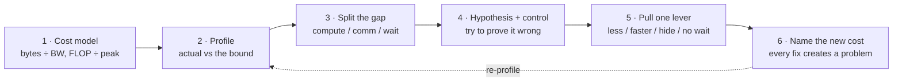

# A First-Principles Methodology for AI Infra Performance Optimization

October 2026 · Companion to [Five principles](00-principles.md): those are the recurring ideas; this note is the procedure for deriving new ones.

## Introduction: code is getting cheap, judgment is getting valuable

The claim of this document: almost every good performance design in AI infrastructure can be derived from one time formula and a table of hardware resources. Learning the derivation lasts longer than memorizing any single optimization.

Writing code is getting cheaper fast. An AI assistant can write a TMA copy, a warp-level deduplication, or a fused kernel. What it cannot supply is judgment: whether to do it, what to do first, what it costs, and how to prove it worked. Those judgments follow the same logic in GEMM, attention, communication, parallelism, and inference scheduling.

The document has three layers:

1. **Method**: the optimization loop, four levers, and cost models. This part does not change with hardware.
2. **Strategy**: six general design strategies, and where new hardware features come from. Each has examples across the stack, with real code from open-source libraries such as DeepEP where it helps.
3. **Practice**: how to verify an optimization, a worked example (the design chain of DeepEP), and a checklist.

Code references: [deepseek-ai/DeepEP](https://github.com/deepseek-ai/DeepEP) commit `f6aa38f` (V2.5, 2026-10-21). Code is excerpted only to illustrate principles.

## Method: compute the lower bound first, then profile

Optimization does not start with a profile. It starts with a **theoretical lower bound**. A profile tells you where time goes; it cannot tell you how much time it should take.



Each step answers one question:

1. **Cost model**: What is the minimum number of bytes to move and FLOPs to compute? Divide by hardware bandwidth and peak throughput to get the lower bound. For MoE all-to-all, the bound is the bytes that must cross nodes divided by the inter-node (IB) bandwidth.
2. **Profile**: What is the actual time? The gap between actual and bound is the room for optimization. Without a bound, you cannot tell whether 4.9 seconds of communication is a lot or a little.
3. **Split the gap**: Use a timeline profiler (Nsight Systems) to split a step into compute, exposed communication, and host wait. Focus only on the largest part.
4. **Hypothesis and falsification**: After forming a hypothesis, design a control experiment that could disprove it, instead of looking for evidence that supports it.
5. **Pull one lever**: Change one variable at a time. The four levers are in the next section.
6. **Name the new cost**: Every optimization creates a new problem. If you can name the cost, you understand the trade-off. Then go back to step 2.

Steps 1 and 4 are skipped most often, and they are the most valuable. MFU is a product of step 1: the denominator is hardware peak, the numerator is the FLOPs the model must do, and the ratio tells you directly how far you are from the bound.

## Four levers: only four terms in the time formula can move

Any duration can be written as the formula below, so any optimization can only act in four directions. When reading someone else's optimization, first ask which term it moves.

$$
T = T_{\text{fixed}} + \frac{W}{B} - T_{\text{hidden}}
$$

W is the work that must be done (bytes, FLOPs), B is the speed of the resource doing it, T_fixed is overhead independent of work (launches, synchronization, latency), and T_hidden is the part overlapped with other work.

| Lever | Term | Question to ask | Kernel-level example | System-level example |
| --- | --- | --- | --- | --- |
| Do less | Shrink W | Is any work repeated, unnecessary, or larger than it needs to be? | Kernel fusion removes HBM round trips; FlashAttention never writes the S×S matrix | ZeRO removes redundant optimizer states; MoE dispatch deduplication; FP8 communication |
| Do it faster | Grow B | Can it move to a faster resource? | CUDA cores → Tensor Cores; keep data in SMEM and registers | TP inside the node on NVLink; IB once, then NVLink forwarding |
| Hide it | Grow T_hidden | Can it run at the same time as something else? | Double buffering, multi-stage pipelines, warp specialization | DDP gradient buckets overlapped with backward; 1F1B; data prefetch |
| Stop waiting | Shrink T_fixed | Is there a sync, a launch, or a CPU round trip? | Persistent kernels; PDL between adjacent kernels | CUDA Graphs; removing `.item()` syncs; async checkpointing |

Three rules for using them:

- **Find the dominant term first.** When bandwidth-bound, shrinking W helps most. In small-batch cases such as decoding, T_fixed dominates, and cutting launches and syncs matters more than cutting bytes.
- **Levers pull against each other.** Recomputation saves memory but grows W; forwarding cuts slow-link traffic but adds a hop of latency. The goal is to shrink the slowest term, not every term.
- **Every term has a floor.** W has the work that must be done, B has the hardware peak, and T_hidden cannot exceed the work available to overlap. The closer you are to the floor, the smaller the gain, and the sooner you should move to the next bottleneck.

## The first tool: three cost models

A cost model answers two questions before you touch code: how fast can this possibly be, and which resource limits it. Most AI infra problems can be estimated to the right order of magnitude with three models.

### Compute and memory: the roofline

A kernel's lower bound is the larger of the time to compute and the time to move data:

$$
T \ge \max\left(\frac{\text{FLOP}}{P_{\text{peak}}},\ \frac{\text{Bytes}}{B_{\text{HBM}}}\right),\quad I = \frac{\text{FLOP}}{\text{Bytes}}
$$

When arithmetic intensity I is below the hardware's peak FLOPs ÷ bandwidth, the kernel is memory-bound, and the direction is to move fewer bytes (fusion, reuse, lower precision). Above it, the kernel is compute-bound, and the direction is to use Tensor Cores well.

- Large GEMMs and prefill attention: compute-bound.
- RMSNorm, softmax, elementwise ops, and decode attention: memory-bound.
- Consequence: decoding is slow not because it computes a lot, but because every generated token reads all weights and the KV cache once. So nearly every decode optimization either moves fewer bytes or grows the batch.

### Communication: the α-β model

The time of one transfer is a fixed latency α plus bytes divided by bandwidth β:

$$
T_{\text{comm}} = \alpha + \frac{n}{\beta}
$$

- For large messages, n/β dominates, so total bytes and link bandwidth matter. Ring all-reduce sends about 2S per GPU regardless of GPU count, so it suits large messages.
- For small messages, α dominates, so the number of steps matters. A tree needs only O(log N) steps, so it suits small messages. NCCL uses this kind of model to choose between them.
- For a multi-level network, write β for each level (NVLink, PCIe, IB) and find the slowest. Placing parallelism (TP inside a node, PP across nodes) means putting the heaviest traffic on the fastest links according to this table.

### Memory: do the accounting before tuning

Mixed-precision Adam training costs about 16 bytes per parameter (BF16 weights 2 + BF16 gradients 2 + FP32 master weights and two moments 12). Activations scale with batch × sequence × hidden × layers. At inference, the KV cache scales with batch × sequence × KV heads × head dimension × layers.

This accounting decides whether to use ZeRO, whether to recompute, and how much TP/PP to use. It also explains why GQA and MLA allow larger inference batches.

### Using cost models to locate the bottleneck

Put the bounds from the three models next to the measured profile. Whichever term is farthest from its bound is the next target. MFU summarizes this comparison: the numerator is the FLOPs the model must do, the denominator is hardware peak. The numerator must be independent of the implementation; otherwise a fused kernel or a backend change makes the metric drift.

## Strategies 1–3: do less, do it faster, lay out data for the consumer

The first three strategies map to the "do less" and "do it faster" levers. They share one property: they do not change the task, only the amount of work and the resource that does it.

### Strategy 1: remove redundancy

**Principle**: Find what is moved, computed, or stored more than once. Redundancy often hides in naive implementations that process data one logical unit at a time.

| Area | Where the redundancy is | How it is removed |
| --- | --- | --- |
| Kernels | Intermediate results written to HBM and read back | Fusion (RMSNorm + quantization, GEMM + epilogue) |
| Attention | The full S×S score matrix is written out | FlashAttention: tiling + online softmax, keeping only the running max and sum |
| Data parallelism | Every GPU holds a full copy of optimizer states | ZeRO-1/2/3 sharding |
| Loss | The [tokens, vocab] logits are materialized | Cut Cross-Entropy computes only what is needed |
| MoE communication | A token is sent k times, once per expert | Deduplicate by destination GPU: send the data once plus k expert indices |

In DeepEP, the last row happens inside one warp. `__match_any_sync` groups lanes with the same destination, and the lowest lane of each group claims one slot for the group.

```cpp
// ptx.cuh: among lanes holding the same value, only the lowest returns true
bool deduplicate(int value, int lane_idx) {
    return get_master_lane_idx(__match_any_sync(0xffffffff, value)) == lane_idx;
}
```

Be careful: redundancy is sometimes deliberate. Activation recomputation trades extra compute for memory; TP runs LayerNorm redundantly on every GPU in exchange for less communication. The test is whether the resource the redundancy consumes is the bottleneck.

### Strategy 2: move work to resources with headroom

**Principle**: Resources are layered: fast ones are small, slow ones are large. Put frequent, high-volume work on the fast layer, and reserve the slow layer for work that must cross it.

- **Memory hierarchy**: registers > SMEM > L2 > HBM > host memory. Tiling is about reusing data many times in a fast layer.
- **Interconnect hierarchy**: NVLink (about 160 GB/s achievable per GPU on H800) > IB (about 50 GB/s), as measured in the DeepSeek-V3 report. So TP stays inside a node, while PP and DP cross nodes.
- **Compute units**: Tensor Cores are far faster than CUDA cores, while transcendental functions such as exp run on the lower-throughput MUFU. On Blackwell, one bottleneck of FlashAttention 4 is the softmax exponentials.
- **CPU and GPU**: When the GPU idles waiting for CPU preprocessing, either move the work to the GPU or move the CPU work earlier and run it in parallel.

DeepEP's hybrid mode is a textbook case. A token crosses IB only once per remote node, on the same rail, and the receiving GPU fans it out over NVLink. The total number of copies grows, but copies on the slow link roughly halve, and the two links become balanced. The key is to count time, not copies: both links work in parallel, so total time is set by the slower one.

### Strategy 3: lay out data for its consumer

**Principle**: How data is arranged in memory should be decided by the step that consumes it. A little extra effort upstream often removes a whole kernel downstream.

- **Inside kernels**: swizzling and padding avoid SMEM bank conflicts; storing A transposed in SMEM gives MMA contiguous reads.
- **Training data**: sequence packing concatenates short samples so every batch is full, and `cu_seqlens` tells attention where the boundaries are.
- **MoE**: a grouped GEMM needs each expert's tokens to be contiguous. DeepEP V2 writes received tokens directly in that layout, using each expert's prefix sum as a write cursor, so the separate permute step disappears:

```cpp
// dispatch_copy_epilogue.cuh: prefix sum = each expert's start row; atomicAdd claims the next row
dst_tensor_idx = atomicAdd(psum_num_recv_tokens_per_expert + dst_expert_idx, 1);
```

The other side of this strategy is the interface contract. Integrating a fast kernel is often less about tuning it and more about reshaping weights, routing metadata, and autograd to match the layout it expects.

## Strategies 4–6: hide it, stop waiting, budget resources

The last three strategies map to the "hide it" and "stop waiting" levers, plus one resource-allocation principle that applies everywhere. The first three strategies reduce work; these three reduce idle time.

### Strategy 4: overlap and pipeline

**Principle**: Two independent tasks should never wait in line. Cut a large task into chunks so that stage A of one chunk runs at the same time as stage B of another.

The same pattern appears at every level:

| Level | What is cut into chunks | What overlaps |
| --- | --- | --- |
| Kernel | K-dimension tiles | Loading the next tile while computing the current one (double buffering, multi-stage pipelines) |
| Inside an SM | Warp roles | Producer warps move data while consumer warps compute (warp specialization) |
| Communication kernel | The token stream | In DeepEP, scale-out warps issue RDMA while forward warps relay over NVLink |
| Training step | Gradients, micro-batches | DDP gradient buckets with backward; interleaved forward and backward in 1F1B; MoE all-to-all with another micro-batch's compute |
| Data pipeline | Batches | DataLoader prefetching; pinned memory + non-blocking copies |

The cost of chunking is just as universal: smaller chunks overlap better, but each chunk pays fixed overhead (launch, sync, message latency). The best chunk size is where the fixed overhead is just barely hidden.

Pipelining across execution units needs a "data is ready" signal. DeepEP's cross-node forwarding uses a tail pointer with memory ordering, the same structure as the classic ring-buffer interview question:

```cpp
// Producer: data is written first, then the tail advances with release semantics
gin.red_add_rel<ncclTeamTagRail>(tail_ptr, signaled_tail - old_signaled_tail, lane_idx);
// Consumer: read the tail with acquire semantics; all data in [head, tail) is then visible
const auto tail = ptx::ld_acquire_sys<int64_t>(signaled_tail_ptr);
```

### Strategy 5: remove synchronization and CPU round trips

**Principle**: The ideal GPU runs an uninterrupted stream of kernels. Every point where the GPU waits for the CPU, or the CPU waits for the GPU, deserves scrutiny.

Common hidden sync points:

- `.item()`, `.cpu()`, `print(tensor)`, and Python conditionals on GPU tensors.
- Dynamic shapes: the output size depends on a GPU result, so the CPU must wait before it can allocate memory.
- Implicit syncs on the default stream, `cudaMalloc`, and copies from pageable memory.

Matching techniques:

- **Keep decisions on the GPU**: a grouped GEMM finds each expert's tokens with a prefix sum on the GPU, so the CPU never needs the counts.
- **Allocate for the maximum**: decoding and CUDA Graphs allocate at full capacity and use GPU-side counts for the valid range. DeepEP's `do_cpu_sync=False` follows this pattern.
- **Merge launches**: CUDA Graphs, kernel fusion, persistent kernels, and PDL, which lets the next kernel start early.
- **Merge signals**: DeepEP packs a count and an arrival counter into one 64-bit atomic add, which removes a grid-wide sync:

```cpp
// Low 32 bits = this SM's count; high 32 bits +1 means "this SM has arrived"
ptx::red_add(reduction_ptr + i, (1ll << 32) | rank_expert_count[i]);
// When SM 0 sees (status >> 32) == kNumSMs, every SM has added its count
```

### Strategy 6: budget resources instead of maximizing them

**Principle**: SMs, registers, SMEM, memory, and bandwidth are shared budgets. Give a piece of work just enough to stop it being the bottleneck; anything more is taken from somewhere else.

- **Occupancy**: more registers and SMEM per thread means fewer resident warps and less latency hiding, but computing more outputs per thread raises ILP. High occupancy does not mean fast.
- **Communication SMs**: the more SMs a communication kernel uses, the faster the all-to-all and the slower the GEMMs. DeepEP V1 used a fixed default of 20 that users tuned by hand. V2 computes it from the bottleneck link: the number of SMs needed to saturate the slowest link, times a 1.3 margin.
- **Register reallocation**: Hopper's `setmaxnreg` lets warps with different roles in one block hold different numbers of registers. DeepEP's hybrid combine gives data-movement warps 40 registers and the rest to reduction warps.
- **Memory**: recomputation, offloading, and ZeRO sharding all trade another resource (compute, PCIe, communication) for memory. The right choice depends on which resource has headroom.

The test for this strategy is simple: give a piece of work slightly fewer resources. If end-to-end time does not change, it had too much before.

## Hardware evolution: each new feature hardens a previous software bottleneck

"Optimizing for the bottleneck" and "optimizing for new hardware" are the same activity on two time scales. Software engineers push the bottleneck to its limit on today's hardware; the remaining bottleneck becomes a requirement for the next generation; when new hardware arrives, software adopts it.

So the first question about a new feature is not "how do I use it" but **"which bottleneck does it exist to remove"**. Once that is clear, you know when to use it and when it does not matter.

### One thread: data movement takes less and less of the threads

| Generation | Feature | Bottleneck it removes |
| --- | --- | --- |
| Volta | Tensor Cores | Matrix-multiply throughput limited by CUDA cores |
| Ampere | `cp.async` | Threads hold registers while moving data and stall until it arrives |
| Hopper | TMA + byte-counting mbarriers | Each thread moves only 4–16 bytes, so many threads must issue instructions |
| Hopper | WGMMA, warp specialization, `setmaxnreg` | The same warps both move data and compute, with rigid resource allocation |
| Blackwell | TMEM, tcgen05 MMA | Accumulators fill the register file, limiting tile size and pipeline depth |

Each step moves some work from "threads doing it with instructions" to "dedicated hardware doing it asynchronously", freeing threads for other work, or allowing fewer threads.

### Hardware features used by DeepEP

Read this table by the bottleneck each feature removes; that is more useful than memorizing names.

| Feature (minimum architecture) | What it does in DeepEP | Bottleneck it removes |
| --- | --- | --- |
| TMA 1D bulk copy (Hopper) | One lane loads a whole token (hidden + scales + top-k + source index) into SMEM and writes it out | Copies no longer consume a whole warp's instructions and registers, so a few SMs saturate bandwidth |
| TMA store to peer memory (Hopper + NVLink symmetric memory) | Writes directly into another GPU's receive buffer in the node | No intermediate copy for intra-node forwarding |
| Byte-counting mbarrier (Hopper) | Waits for TMA loads to land | Completion by bytes arrived, without polling |
| `elect.sync` (Hopper) | Picks one lane to issue TMA | Cheap leader election |
| `setmaxnreg` (Hopper) | In hybrid combine, 40 registers for data-movement warps, the rest for reduction warps | Different warp roles need different register budgets |
| PDL (Hopper) | The dispatch kernel triggers before it ends, so the copy epilogue launches early | Launch gaps between adjacent kernels |
| GPU-initiated RDMA (NCCL Gin, IBGDA-style) | The kernel posts writes to the NIC itself | A CPU proxy thread and its round-trip latency in the data path |
| L2 cache hint `evict_first` | Read-once tokens do not occupy L2 | Streaming data polluting the cache |
| NVLink SHARP (multimem, Hopper + NVSwitch) | Experimental bucket all-reduce / reduce-scatter reduce inside the switch | Reductions consuming SMs and extra transfers |
| Batched copy-engine transfers | Bucket all-gather runs with `num_sms=0` | Pure copies consuming SMs |
| `st.bulk` (Blackwell) | Zeroes SMEM in one instruction, with a loop fallback on older GPUs | Zeroing also costs instructions |
| FP8 (Hopper) | FP8 dispatch | Roughly halves communication bytes |

In code, TMA looks like this: one PTX instruction describes source, destination, size, and which mbarrier to signal on completion. The issuing thread is then free to do other work.

```cpp
// ptx.cuh: one thread issues a whole bulk copy
"cp.async.bulk.shared::cluster.global.mbarrier::complete_tx::bytes.L2::cache_hint"
"[%0], [%1], %2, [%3], %4;"   // dst_smem, src_global, num_bytes, mbarrier, L2 hint
```

### The reverse loop: software hands requirements to hardware

The DeepSeek-V3 technical report records the other half of this loop. Their communication kernels used about 20 SMs during training, which is also where DeepEP V1's default came from. In its hardware suggestions, the report asks for communication to be offloaded to a dedicated co-processor so SMs can do only compute. Copy engines and NVLink SHARP move in that direction.

Three questions for any new hardware feature:

1. What work does it take away from threads?
2. What does it cost or constrain (alignment, granularity, architecture dependence, need for a fallback path)?
3. In my workload, is the work it takes away actually the bottleneck?

## Verification: five gates before an optimization counts

Measuring "it got faster" is not enough. An optimization holds only when it is shown to be fast, correct, stable, and fast end to end, and when you know why it is fast.

1. **Compare against the bound**: How far is the result from the theoretical lower bound? If it is close, move to the next bottleneck instead of squeezing this one.
2. **Single-variable control**: Change one factor at a time and hold everything else fixed (token budget, sample order, parallel configuration). Use controls to try to disprove your hypothesis, not just to confirm it.
3. **Numerical correctness**: Compare forward outputs and backward gradients with relative metrics such as normalized L2 and explicit tolerances. Cover the shape space (variable length, causal, head dimensions, GQA), and keep a fallback path for configurations that fail or regress. At the training level, also compare loss curves.
4. **Steady state and repetition**: Warm up, time many iterations, repeat several runs, and report the coefficient of variation. A number measured once cannot be trusted.
5. **End-to-end confirmation**: A microbenchmark gain does not always reach the training step; it can vanish because the work was already overlapped or another bottleneck dominates. Always re-measure in a real training job.

The metric itself must also hold up. MFU must use the peak throughput for the precision in use as its denominator, and implementation-independent logical FLOPs as its numerator. If the numerator is derived only from the model configuration and runtime token counts, no kernel change, fusion, or recomputation setting can inflate it.

## Worked example: DeepEP's design is a chain of problems

DeepEP's design is not a set of isolated tricks. It is a chain: each solved problem exposes the next, until what remains is small enough. The table lists the chain as problem, design, strategy, and new cost.

**Starting point**: the lower bound of MoE all-to-all is the bytes that must cross nodes divided by IB bandwidth. IB is the slowest link, so everything aims at reducing bytes on IB.

| # | Problem | Design | Strategy | New problem it creates |
| --- | --- | --- | --- | --- |
| 1 | A token is sent k times, once per expert; the data repeats | Deduplicate by destination GPU: send the data once plus k indices | 1 Remove redundancy | 32 GPUs are too spread out; deduplication saves only about 8% |
| 2 | Several GPUs in the same node each receive a copy, so IB still carries repeats | Cross IB once per remote node (same rail), then fan out over NVLink | 2 Move to headroom | An extra hop; the forwarder must know when data has arrived |
| 3 | There are no locks across nodes; how does the receiver know data arrived? | A lock-free ring buffer per channel with a release/acquire tail, updated in batches | 4 Pipeline | Each tail update is an RDMA atomic, which costs time |
| 4 | The receiver does not know in advance how much it will get | Notify warps count first, exchange counts, and compute prefix sums | 5 Stop waiting | Whether to tell the CPU the counts |
| 5 | Prefix sums exist, but permuting still takes a separate kernel | Use the prefix sum as a write cursor to write an expert-contiguous, tile-aligned layout | 3 Layout for the consumer | Output capacity and alignment must be agreed in advance |
| 6 | The CPU needs sizes to allocate tensors | Training syncs for exact sizes; decoding skips the sync and allocates for the maximum; backward replays the handle | 5 Stop waiting | The synced mode can create host wait |
| 7 | Communication kernels take SMs that GEMMs need | TMA + GPU-initiated RDMA issued by one lane; SM count computed from the bottleneck link | 6 Budget resources | With few SMs, the pipeline must be deeper |
| 8 | Within one dispatch, data arrives all or nothing | The library exposes streams, events, and deferred epilogues; the framework decides scheduling | 4 Overlap | Overlap granularity depends on how the framework splits micro-batches |

Step 2's benefit must be counted in time, not copies. With 128 experts, top-8, and 32 GPUs across 4 nodes, assuming uniform random routing:

| Mode | IB copies / token | NVLink copies / token | IB time ∝ copies ÷ 50 | NVLink time ∝ copies ÷ 160 | Bottleneck time |
| --- | --- | --- | --- | --- | --- |
| Direct | 5.5 | 1.6 | 0.110 | 0.010 | 0.110 |
| Hybrid | 2.7 | 6.4 | 0.054 | 0.040 | 0.054 |

The lesson of this chain is not any single trick but that **every step questions the cost left by the previous one**. Deduplication left "too spread out", forwarding left "synchronization", counting left "does the CPU need to know". When you follow the chain all the way, the design is derived rather than invented.

## Checklist

Go through this list in order for any new performance problem.

- [ ] Write down the theoretical lower bound for the work and name the resource that sets it (compute, HBM, NVLink, IB, PCIe, CPU).
- [ ] Profile and split time into compute, exposed communication, and waiting; measure the gap to the bound.
- [ ] Form a hypothesis about the largest part, and design a control experiment that could disprove it.
- [ ] Choose a lever: can it do less, run on a faster resource, be hidden, or stop waiting?
- [ ] Check the resource budget: which shared resource (SMs, registers, memory, bandwidth) did this optimization take from?
- [ ] Name the new cost this optimization introduces, and judge whether it will become the next bottleneck.
- [ ] Verify: numerical correctness, single-variable controls, steady-state repetition, end-to-end re-measurement.
- [ ] Return to the second item.
