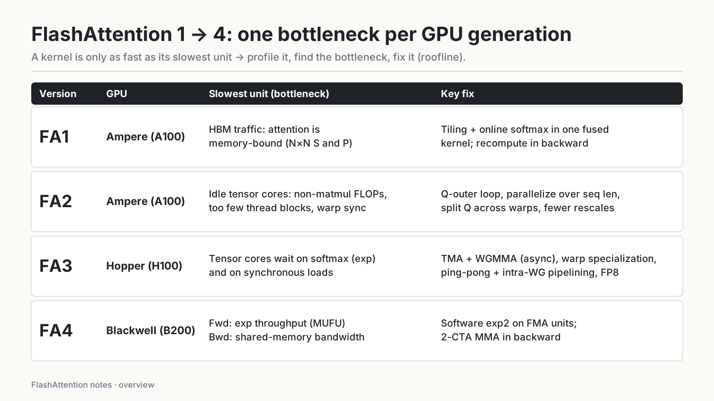
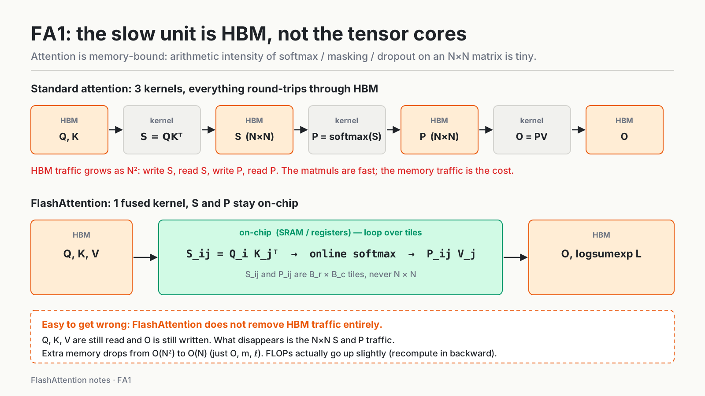
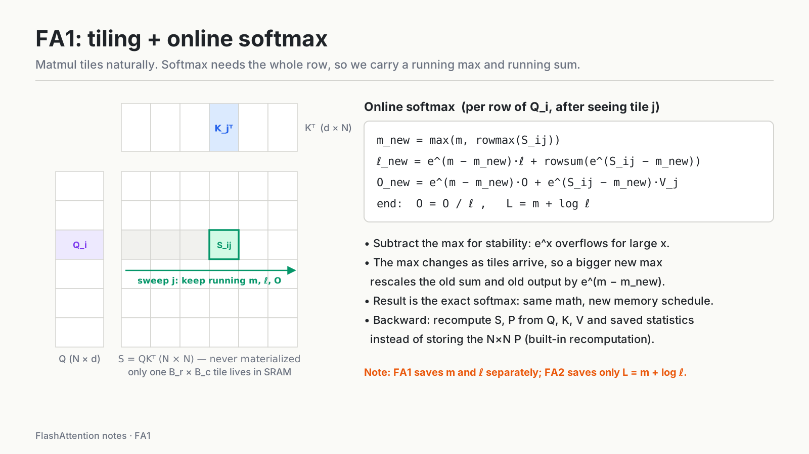

# FlashAttention-1: IO-aware exact attention

**Question:** if the matmuls in attention are fast, why is attention slow, and how do you fix it without approximating anything?

- GPU: Ampere (A100)
- Slowest unit: HBM traffic. Attention is memory-bound.
- Fix: tiling + online softmax fused into one kernel; recomputation in the backward pass.

Series: [overview](../02-flashattention-1-to-4.md) · **FA1** · [FA2](02-flashattention-2.md) · [FA3](03-flashattention-3.md) · [FA4](04-flashattention-4.md)



The idea that ties the series together: a kernel is only as fast as its slowest unit. Profile, find the real bottleneck, then fix that. Each GPU generation has a different hardware balance, so each FlashAttention version targets a different unit. For FA1 on the A100, that unit is HBM.

---

## 1. Background: the A100 memory hierarchy

Numbers from the FA1 paper:

- **HBM:** 40–80 GB, 1.5–2.0 TB/s
- **On-chip SRAM** (shared memory / L1): 192 KB per SM × 108 SMs, about 19 TB/s (estimated)

SRAM is roughly an order of magnitude faster than HBM and roughly five orders of magnitude smaller. FA1's whole idea is to finish as much work as possible in SRAM and touch HBM as little as possible. That is what "IO-aware" in the title means.

In roofline terms: the A100's FP16 tensor-core peak is about 312 TFLOPS. Divided by 1.5–2.0 TB/s, the ridge point sits around 150–200 FLOPs/byte. The matmuls ($QK^\top$, $PV$) have high arithmetic intensity and are compute-bound. Elementwise ops such as softmax, masking, and dropout read each element, do a few operations, and write it back. Their intensity is about 1 FLOP/byte, far below the ridge point, so they are heavily memory-bound.

---

## 2. The real problem with standard attention: HBM traffic



Standard attention for one head, with $Q, K, V \in \mathbb{R}^{N \times d}$:

$$S = QK^\top \in \mathbb{R}^{N\times N}, \qquad P = \mathrm{softmax}(S), \qquad O = PV \in \mathbb{R}^{N\times d}$$

A naive implementation runs three kernels:

1. Read Q and K from HBM, compute $S$, **write the N×N S to HBM**.
2. **Read S back**, compute $P = \mathrm{softmax}(S)$, **write the N×N P to HBM**.
3. **Read P back** with V, compute $O$, write O to HBM.

HBM accesses are $\Theta(Nd + N^2)$. Usually $N \gg d$ (N from 4K to 128K, d from 64 to 128), so the $N^2$ term dominates. Backward also needs P, so P has to be stored, and memory is $O(N^2)$ too.

> **My understanding**
>
> My first instinct was that attention is slow because it computes a lot. It doesn't: the matmuls are fast, and GEMMs run very efficiently on tensor cores. The real cost is that **two N×N matrices travel through HBM four times** (write S, read S, write P, read P). Attention is a memory-bound kernel, so the way to speed it up is to move less data, not to compute less.
>
> One thing I had wrong before: FlashAttention **does not eliminate HBM traffic**. Q, K, V are still read from HBM and O is still written back. What it removes is the traffic for the **N×N intermediates S and P**, which never leave the chip. That is also why extra memory drops from $O(N^2)$ to $O(N)$.

---

## 3. Tiling + online softmax



### 3.1 Tiling

1. Split Q into row blocks $Q_i$ ($B_r \times d$). Split K and V into row blocks $K_j, V_j$ ($B_c \times d$).
2. Load one $Q_i$ and one $K_j, V_j$ from HBM into SRAM at a time.
3. Compute $S_{ij} = Q_i K_j^\top$ ($B_r \times B_c$) on-chip, then $P_{ij}$, then $P_{ij} V_j$. The data path is HBM → shared memory → registers.
4. At any moment only **one $B_r \times B_c$ tile of S** exists on-chip. The full N×N S is never materialized.

FA1 picks block sizes from the SRAM size $M$ so that $Q_i, K_j, V_j, O_i$ and the S tile fit together:

$$B_c = \left\lceil \tfrac{M}{4d} \right\rceil, \qquad B_r = \min\!\left(\left\lceil \tfrac{M}{4d} \right\rceil, d\right)$$

Matmul tiles naturally: an output block is just a sum of block products. **Softmax does not**, because it needs the max and the sum of the whole row. That is the problem online softmax solves.

### 3.2 Why softmax subtracts the max

$e^x$ overflows for large $x$ (in FP16, $e^{12}$ already exceeds 65504). Stable softmax subtracts the row max first:

$$\mathrm{softmax}(x)_k = \frac{e^{x_k - m}}{\sum_t e^{x_t - m}}, \quad m = \max_t x_t$$

With tiling, after seeing only some of the K blocks, we don't yet know the row's true max.

### 3.3 The online softmax update

For each row, keep a **running max** $m$, a **running denominator** $\ell$, and a **running output** $O$. For each new tile $j$:

$$m^{\text{new}} = \max\!\big(m,\ \mathrm{rowmax}(S_{ij})\big)$$

$$\ell^{\text{new}} = e^{\,m - m^{\text{new}}}\,\ell \;+\; \mathrm{rowsum}\!\big(e^{\,S_{ij} - m^{\text{new}}}\big)$$

$$O^{\text{new}} = e^{\,m - m^{\text{new}}}\,O \;+\; e^{\,S_{ij} - m^{\text{new}}}\,V_j$$

After the last tile: $O \leftarrow O / \ell$.

(Algorithm 1 in the FA1 paper normalizes $O$ at **every** step. The form above, which keeps $O$ unnormalized and divides by $\ell$ once at the end, is an FA2 change; see the FA2 note. The two are mathematically equivalent.)

> **My understanding**
>
> The key to online softmax is **maintaining a running max and running sum while reading tiles**. The $\ell$ and $O$ computed so far are relative to the old max $m$. If a new tile contains a larger value, multiply by the correction factor $e^{m - m^{\text{new}}}$ (which is less than 1) to rescale the old sum and the old output to the new max. If the max didn't change, the factor is 1 and nothing changes.
>
> After all tiles are read, the result is **identical** to computing the whole row's softmax at once. FlashAttention is **exact** attention, not an approximation. The math doesn't change at all; only the order of computation and where the data lives change.

---

## 4. The FA1 forward algorithm

FA1 puts **K/V in the outer loop and Q in the inner loop**:

```text
for j in 1..T_c:                          # outer: K/V blocks
    load K_j, V_j  HBM → SRAM
    for i in 1..T_r:                      # inner: Q blocks
        load Q_i, O_i, ℓ_i, m_i  HBM → SRAM
        S_ij = Q_i K_jᵀ                   # on-chip
        m̃_ij = rowmax(S_ij);  P̃_ij = exp(S_ij − m̃_ij);  ℓ̃_ij = rowsum(P̃_ij)
        m_i_new = max(m_i, m̃_ij)
        ℓ_i_new = e^(m_i − m_i_new)·ℓ_i + e^(m̃_ij − m_i_new)·ℓ̃_ij
        O_i = diag(ℓ_i_new)⁻¹ ( diag(ℓ_i)·e^(m_i − m_i_new)·O_i + e^(m̃_ij − m_i_new)·P̃_ij V_j )
        write O_i, ℓ_i_new, m_i_new  SRAM → HBM
```

Note that $O_i, \ell_i, m_i$ are read from HBM and written back **on every inner iteration**. This is exactly what FA2 removes.

---

## 5. IO complexity

- Standard attention: $\Theta(Nd + N^2)$ HBM accesses, $O(N^2)$ extra memory.
- FlashAttention: $\Theta(N^2 d^2 M^{-1})$ HBM accesses, $O(N)$ extra memory (just $\ell$ and $m$).

With typical $d$ = 64–128 and $M$ ≈ 100 KB, $d^2$ is many times smaller than $M$, so HBM accesses drop sharply. The paper also proves a lower bound: over the whole range $d \le M \le Nd$, no exact attention algorithm can asymptotically do better.

FLOPs don't go down. Recomputation in backward actually makes them go slightly **up**. FA1 is faster purely because it moves less data.

---

## 6. Backward pass: recomputation

- Standard backward needs the N×N $P$ saved from the forward pass.
- FA1 saves only $O$, the softmax statistics $(m, \ell)$, and the dropout RNG state.
- In backward, it **recomputes** $S_{ij}$ and $P_{ij}$ tile by tile from $Q, K, V$ and the statistics.

This is selective activation checkpointing **built into the kernel**: spend a few extra FLOPs (cheap) to avoid a lot of HBM traffic (expensive). Even with the extra compute, backward is faster than standard attention, because standard attention is memory-bound.

The identity that lets $dS$ be computed tile by tile:

$$D_i = \mathrm{rowsum}(dO_i \circ O_i), \qquad dS_{ij} = P_{ij} \circ (dP_{ij} - D_i)$$

A detail: FA1 saves $m$ and $\ell$ **separately**. Saving a single logsumexp $L = m + \log \ell$ is an FA2 change.

---

## 7. Results and limits

All figures are as reported in the FA1 paper; I have not reproduced them.

- BERT-large (seq 512): 15% faster end-to-end training than the MLPerf 1.1 record.
- GPT-2 (seq 1K): up to 3× faster than the HuggingFace / Megatron implementations.
- Long-Range Arena (seq 1K–4K): 2.4× faster.
- Longer context gives better models: GPT-2 with 4K context improves perplexity by 0.7, and FA gave the first better-than-chance results on Path-X (16K) and Path-256 (64K, with block-sparse FA).
- Block-sparse FlashAttention skips all-zero blocks of a sparsity mask and was faster than every approximate attention method the paper tested.

**Limit:** FA1 reaches only **25–40%** of the A100's theoretical peak FLOPs/s, while a well-optimized GEMM reaches 80–90%. HBM is no longer the main bottleneck, so where did the rest of the time go? That is the question FA2 answers.

---

## References

- Dao et al., *FlashAttention: Fast and Memory-Efficient Exact Attention with IO-Awareness*, NeurIPS 2022. [arXiv:2205.14135](https://arxiv.org/abs/2205.14135)
- Milakov & Gimelshein, *Online normalizer calculation for softmax*, 2018. [arXiv:1805.02867](https://arxiv.org/abs/1805.02867)
