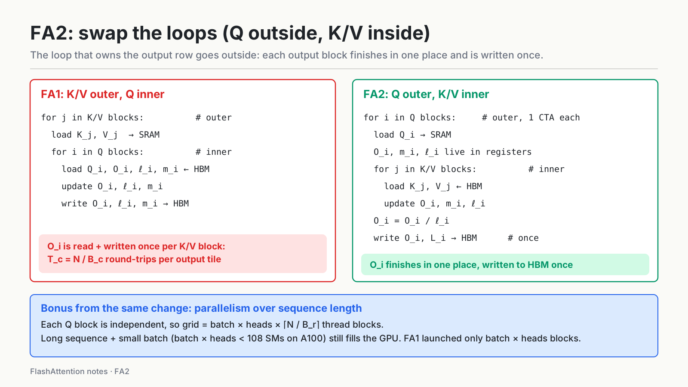
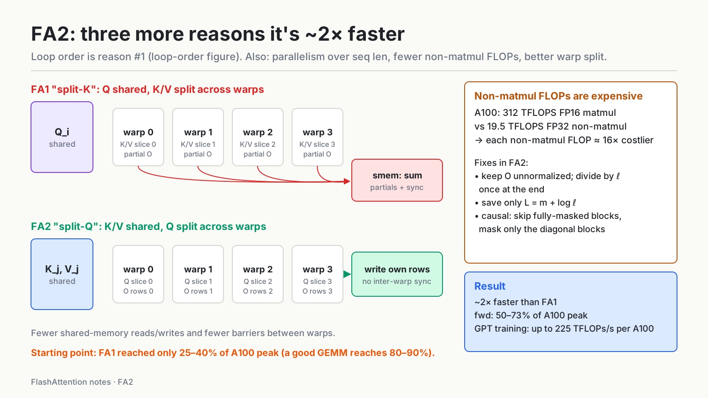

# FlashAttention-2: keep the tensor cores busy

**Question:** FA1 fixed HBM traffic, so why does it still reach only 25–40% of A100 peak, and what does FA2 change?

- GPU: Ampere (A100)
- Slowest unit: idle tensor cores. HBM is no longer the main problem, but the GPU still isn't full.
- Fix: Q in the outer loop, parallelism over sequence length, fewer non-matmul FLOPs, split-Q across warps.

Series: [overview](../02-flashattention-1-to-4.md) · [FA1](01-flashattention-1.md) · **FA2** · [FA3](03-flashattention-3.md) · [FA4](04-flashattention-4.md)

---

## 1. Starting point: FA1 reaches only 25–40% of peak

After fixing HBM traffic, FA1 still reaches only **25–40%** of the A100's theoretical peak FLOPs/s, while a well-optimized GEMM on the same GPU reaches **80–90%**.

> **My understanding**
>
> Following "a kernel is only as fast as its slowest unit": after FA1, the slowest unit is no longer HBM. It is **the tensor cores waiting**. So the question becomes: what are they waiting for?
>
> The FA2 paper finds four reasons:
>
> 1. **Wrong loop order:** outputs go back and forth to HBM repeatedly (§2).
> 2. **Not enough parallelism:** with long sequences and small batches, SMs sit idle (§3).
> 3. **Too much non-matmul work:** it runs on the slow CUDA cores (§4).
> 4. **Bad work split between warps:** warps have to communicate and sync through shared memory (§5).
>
> "Swap the loop order" alone is an incomplete explanation. It takes all four to explain why FA2 is about 2× faster.

---

## 2. Change 1: swap the loops, Q goes outside



**FA1: K/V outer, Q inner**

```text
for j in K/V blocks:              # outer
    load K_j, V_j → SRAM
    for i in Q blocks:            # inner
        load Q_i, O_i, ℓ_i, m_i ← HBM
        update O_i, ℓ_i, m_i
        write O_i, ℓ_i, m_i → HBM  # every iteration
```

**FA2: Q outer, K/V inner**

```text
for i in Q blocks:                # outer, one thread block (CTA) per Q block
    load Q_i → SRAM
    O_i, m_i, ℓ_i live in registers
    for j in K/V blocks:          # inner
        load K_j, V_j ← HBM
        S_ij = Q_i K_jᵀ
        m_new = max(m_i, rowmax(S_ij))
        P̃_ij = exp(S_ij − m_new)
        ℓ_i  = e^(m_i − m_new)·ℓ_i + rowsum(P̃_ij)
        O_i  = e^(m_i − m_new)·O_i + P̃_ij V_j     # unnormalized
        m_i  = m_new
    O_i = O_i / ℓ_i                               # normalize once
    L_i = m_i + log ℓ_i
    write O_i, L_i → HBM                          # write once
```

> **My understanding**
>
> The key is **who owns the output**:
>
> - Output row $i$ depends only on row $i$ of Q (and on all of K and V). So Q "owns" the output rows, and K, V are inputs that every query has to scan through completely.
> - If **Q is in the inner loop** (FA1), each step of the outer loop produces only a **partial** $O_i$. It has to be written to HBM and read back on the next round to keep accumulating. Each output tile makes $T_c = N / B_c$ round trips.
> - If **Q is in the outer loop** (FA2), $O_i$ **stays in registers** for the whole inner loop. When the inner loop ends, $O_i$ is finished and is written to HBM **exactly once**.
>
> In one sentence: **the loop that decides the output goes outside, so each output block is finished in one place and written once.** Just swapping the loop order removes another big chunk of HBM traffic.

---

## 3. Change 2: parallelize over sequence length

This is really a by-product of the loop swap. It is in the bottom of the figure above.

- **FA1** parallelizes only over **batch × heads**: one thread block per (batch, head).
- The A100 has **108 SMs**. With long sequences, batch has to be small to fit in memory. Once batch × heads < 108, some SMs sit idle.
- **FA2** also parallelizes over the **sequence dimension**. Each Q block owns its own output rows and is independent of the others, so:

$$\text{grid} = \text{batch} \times \text{heads} \times \left\lceil N / B_r \right\rceil \ \text{thread blocks}$$

> **My understanding**
>
> This is exactly what Q-outside buys you: since each Q block owns only its own output and needs no communication with the others, each Q block can simply be its own thread block. Even with a tiny batch, a long enough sequence fills the GPU.

In backward, FA2 parallelizes over **K/V blocks** instead (each thread block owns its $dK_j, dV_j$). $dQ$ is shared across blocks, so it is accumulated with **atomic adds**.

---

## 4. Change 3: fewer non-matmul FLOPs



On the A100 the two kinds of math run at very different speeds:

- Tensor cores (FP16/BF16 matmul): 312 TFLOPS
- CUDA cores (FP32 non-matmul): 19.5 TFLOPS

So **one non-matmul FLOP costs about 16× more** than a matmul FLOP. Even a small fraction of non-matmul work can take most of the time.

What FA2 does (right side of the figure):

1. **Delay normalization.** FA1 rescales $O$ by $\ell$ every iteration. FA2 keeps $O$ **unnormalized** and divides by $\ell$ once at the end.
2. **Save only logsumexp.** Instead of saving both $m$ and $\ell$ for backward, save $L = m + \log \ell$, and recover $P = \exp(S - L)$ directly in backward.
3. **Causal masking.** Blocks entirely above the diagonal are fully masked, so **skip them** (about half the blocks for long sequences). Apply the mask only on **diagonal blocks**.

> **My understanding**
>
> This is "find the slowest unit" again. The tensor cores are so fast that the little bit of rescaling, exp, and masking done outside them becomes what holds the kernel back. The goal is not fewer total FLOPs; it is fewer FLOPs **on the slow unit**.

---

## 5. Change 4: split-Q across warps

A thread block usually has 4 (or 8) warps. The question is how to divide work between them (left side of the figure).

**FA1: "split-K" (sliced-K)**

- All warps share $Q_i$; **$K_j, V_j$ are split** across warps.
- Each warp computes only part of $Q_i K_{j,w}^\top$, so it gets only a **partial sum** of $O_i$.
- The partial sums have to be **written to shared memory, synchronized, and added**: extra shared-memory traffic and barriers.

**FA2: "split-Q"**

- All warps share $K_j, V_j$; **$Q_i$ is split** across warps.
- Each warp computes the full $Q_{i,w} K_j^\top$ for its own rows, so it gets **the complete output for its rows**.
- Producing the output needs **no communication between warps**.

> **My understanding**
>
> This is **the same idea as the loop swap, pushed down to the warp level**: let each worker exclusively own a slice of the output. Whoever owns an output never has to merge results with anyone else, so there are no extra reads, writes, or syncs. At the thread-block level, a Q block owns output rows; at the warp level, a slice of Q owns output rows.

---

## 6. Other details

- **Block sizes:** $B_r, B_c \in \{64, 128\}$, tuned for head dim and shared-memory budget. Larger blocks mean fewer HBM loads but more register and shared-memory pressure; too large causes register spills.
- **Head dim:** up to 256.
- **MQA / GQA:** supported by indexing the shared K/V head, without copying K/V in memory.
- **Implementation:** built on CUTLASS 3.x / CuTe, using `mma.sync` (tensor-core instructions) and `cp.async` (async copies) on Ampere.

---

## 7. Results

All figures are as reported in the FA2 paper; I have not reproduced them.

- About **2×** faster than FA1.
- Forward reaches **50–73%** of A100 theoretical peak (FA1: 25–40%), close to GEMM efficiency.
- End-to-end GPT-style training: up to **225 TFLOPs/s per A100**, which is **72% MFU**.

---

## 8. What goes wrong on Hopper

FA2 is tuned for Ampere. On Hopper (H100) it reaches only about **35%** utilization:

- It uses Ampere-style **synchronous** instructions (`mma.sync`) and doesn't use Hopper's new async hardware (TMA, WGMMA).
- On Hopper, matmul got much faster, so the **exp** in softmax becomes a noticeable share of runtime.

FA3 is redesigned around these two points. See the next note.

---

## References

- Dao, *FlashAttention-2: Faster Attention with Better Parallelism and Work Partitioning*, ICLR 2024. [arXiv:2307.08691](https://arxiv.org/abs/2307.08691)
- Dao et al., *FlashAttention* (FA1). [arXiv:2205.14135](https://arxiv.org/abs/2205.14135)
